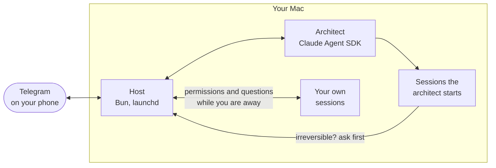

<div align="center">

# Architect

**Run Claude Code on your Mac from Telegram.**

An AI architect starts and watches your Claude Code sessions, sends their questions to your phone as buttons, and asks for your tap before deploys and deletions.

[](https://github.com/sternblut/architect/actions/workflows/test.yml)
[](LICENSE)
[](#quick-start)
[](https://bun.sh)
[](https://github.com/anthropics/claude-agent-sdk-typescript)

[Quick start](#quick-start) · [How it works](#how-it-works) · [Commands](#commands) · [Security](#security) · [Русский](README.ru.md)

</div>

You start a long Claude Code run and walk away. A session stops to ask for permission, a deploy waits for a yes, a question sits in a terminal nobody is looking at. Architect is a Telegram bot that runs on your Mac and brings all of it to your phone.

> [!NOTE]
> The bot speaks English or Russian: `"lang": "en"` or `"ru"` in `config.local.json`.

## What you get

- **Ask in plain words.** The architect, a Claude agent built with the Claude Agent SDK, starts Claude Code sessions in the folders your request is about, passes your messages on to them, sets their goals, restarts and stops them.
- **Your own sessions too.** After 3 minutes without keyboard or mouse input, permission requests and multiple-choice questions from Claude Code sessions on the Mac, including the ones you started in a terminal, arrive in Telegram as buttons. When you are back, anything still waiting returns to the terminal.
- **Irreversible steps wait for your tap.** Before a session the architect started runs a command, a policy gate checks it. Deleting files, pushing to main, deploying and sending email wait for your button, and stay blocked while the bot is off. Deploying by hand over ssh, scp, rsync or FTP is refused. The gate matches commands against rules: a guard rail, not a sandbox.
- **Decisions in one line.** A request opens with what will change, whether it can be undone and, when the facts allow, a recommendation. The command and the changed files are one tap deeper.
- **One pinned dashboard.** Who is waiting for you, what is running, whether your sites respond and how much of your weekly Claude limit is used. The bot edits it instead of posting new messages.
- **The deploy, as a screenshot.** After you allow a push or merge, the bot waits for the GitHub Actions run and reports how it went. For a site linked to its repository, it sends a phone-sized screenshot of the live page.
- **Quiet nights.** From midnight to 8:00 messages arrive without sound, and reports you did not ask for are held back. At 8:00 you get one summary of the night. You are woken only if work you expect by morning is about to stop.
- **Promises kept.** When the architect says it will send something once a session finishes, or remind you at 9:30, the host records the promise and reminds the architect on time, even after a restart. If the Claude limit has run out, the bot tells you and returns to the promise after the reset.
- **Voice, transcribed on your Mac.** Send a voice message instead of typing: [mlx-whisper](https://github.com/ml-explore/mlx-examples/tree/main/whisper) turns it into text locally, offline.

## Quick start

You need a Mac with [Claude Code](https://code.claude.com/docs/en/setup) signed in, and Telegram on your phone.

**1. Install the plugin.** In Claude Code:

```
/plugin install architect --marketplace sternblut/architect
```

Claude Code installs the dependencies itself. The host runs on [Bun](https://bun.sh) 1.2 or newer; the next step offers to install it.

**2. Connect.** In Claude Code:

```
/architect:connect
```

Claude walks you through it. A QR code opens on the Mac screen; you enter the code it shows in Telegram and tap the button that creates your own bot. Until one-button connection is enabled for this distribution, it asks you to create a bot in [@BotFather](https://t.me/BotFather) instead. The token then goes through a hidden macOS dialog straight into the Keychain, never into the chat.

**3. Write to your bot.** It asks which folders to work in, which sites to watch and whether to follow your GitHub runs. Then send your first task, in plain words or by voice.

`/architect:off` turns everything off. Updates come with the plugin: `/plugin` → architect → Update. Your settings, the bot's state and the architect's conversation live in `~/.claude/plugins/data/architect-sapfir/` and survive updates.

### From source

For development, or to run from your own clone. You also need a bot from [@BotFather](https://t.me/BotFather): send `/newbot` and keep the token.

```sh
git clone https://github.com/sternblut/architect.git
cd architect
bun install
bunx playwright-core install webkit chromium   # browsers for site screenshots
bin/arch token   # paste the bot token; it goes to the macOS Keychain
bin/arch on      # start the host now and at every login
bin/arch pair    # prints a link with a one-time code: open it on your phone and write anything
```

`config.json` in the repository is a shared template. The setup in the chat writes your folders, sites and GitHub to `config.local.json`, which git does not track, so `archi update` never runs into your changes. The bot speaks English; for Russian, start with `echo '{ "lang": "ru" }' > config.local.json`.

Optional, run from the same folder:

- `ln -s "$PWD/bin/arch" ~/.local/bin/archi` gives you the `archi` command used below.
- `echo "source \"$PWD/bin/claude-wrap.zsh\"" >> ~/.zshrc` lets the bot restart a session you started in a terminal, in the same tab.
- `gh auth login`, then `/setup` in the chat, lets the bot follow your GitHub runs and pull requests.
- Turn on Threaded Mode for your bot in @BotFather to give each session its own topic.
- Deploy screenshots: give a site its repository in `config.local.json`, for example `{ "name": "Landing", "url": "https://example.com/", "repo": "landing" }` in `sites`, then `bin/arch restart`. `/setup` rewrites `sites`.
- Voice, Apple Silicon only: add to `config.local.json` `"voice": { "whisper": "/path/to/mlx_whisper", "model": "mlx-community/whisper-large-v3-turbo", "language": "en" }`. Download the model into your Hugging Face cache first: the host runs it offline.

## How it works



- **Host.** A Bun process that `archi on` registers with launchd, so it starts at login. It talks to Telegram through grammY and keeps the Mac from idle sleep while it runs.
- **Architect.** A Claude agent (Opus by default) with tools to start, message, restart and stop sessions, set goals, read session logs and take screenshots.
- **Shared hook.** `archi on` adds three entries to `~/.claude/settings.json`, so Claude Code sessions on the Mac report to the host. `archi off` removes them.
- **Policy gate** ([`src/policy.ts`](src/policy.ts)). Checks every tool call of the architect's sessions before it runs. Your answers are logged to `logs/decisions.jsonl`.
- **Cloud relay, optional** ([`relay/`](relay/)). A Cloudflare Worker for when the Mac sleeps: it says so, answers `/status` with the last summary and queues your messages until the Mac wakes. It holds no bot token or private key and never accepts a decision.

## Commands

| Command | What it does |
|---|---|
| `archi on` | Start the host and turn on start at login |
| `archi off` | Turn everything off: the bot goes quiet and the shared hook is removed. Sessions keep running |
| `archi off --all` | The same, and stop the sessions the architect started |
| `archi status` | Host, pairing, token, version, last log lines |
| `archi logs [-f]` | Host log |
| `archi restart` | Restart; waits up to 2 minutes for the architect to finish its reply |
| `archi update` | Pull the latest version from GitHub and restart. Your settings in `config.local.json` are not touched |
| `archi rollback` | Back to the version before the last update; `archi update` returns to the latest |
| `archi pair` | Print the pairing link and code: the first pairing or moving the bot to another Telegram account (the previous one is told) |
| `archi token` | Save the bot token to the Keychain |
| `archi ask "what to do"` | Ask you with a button in Telegram. Exits with 0 only if you allow |
| `archi uninstall` | Stop the architect's sessions; remove the service, the hook, the saved bot token and the `archi` command |

In Telegram you just write. `/status` returns the dashboard, `/stop` interrupts the architect's current reply, `/new` starts the conversation over. To answer a session, reply to its message.

## Security

- The bot obeys only the Telegram account you paired with a six-digit code from your Mac. The code expires after 30 minutes or five wrong attempts.
- Forwarded messages, web pages, files and tool output are data, not instructions. A forwarded "yes" is not a decision.
- The bot token lives in the macOS Keychain. The policy gate blocks the usual commands that would read it from the architect's sessions, and logs and messages are scrubbed of secrets.

To report a vulnerability, see [SECURITY.md](SECURITY.md).

## Docs

The user guide ([docs/guide.ru.md](docs/guide.ru.md)) and the design notes ([DESIGN.md](DESIGN.md), [DECISIONS.md](DECISIONS.md)) are in Russian for now.

## License

[MIT](LICENSE)
