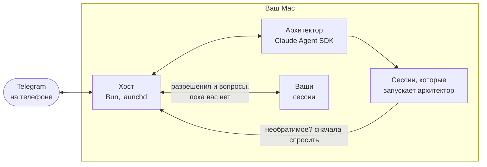

<div align="center">

# Архитектор

**Claude Code на вашем Mac — из Telegram.**

ИИ-архитектор запускает сессии Claude Code и следит за ними, приносит их вопросы на телефон кнопками и перед выкладкой и удалением ждёт вашего нажатия.

[](https://github.com/sternblut/architect/actions/workflows/test.yml)
[](LICENSE)
[](#быстрый-старт)
[](https://bun.sh)
[](https://github.com/anthropics/claude-agent-sdk-typescript)

[Быстрый старт](#быстрый-старт) · [Как устроено](#как-устроено) · [Команды](#команды) · [Безопасность](#безопасность) · [English](README.md)

</div>

Вы запускаете долгую работу Claude Code и уходите. Сессия останавливается спросить разрешения, выкладка ждёт «да», вопрос висит в терминале, на который никто не смотрит. Архитектор — бот Telegram, который работает на вашем Mac и приносит всё это на телефон.

## Что вы получаете

- **Просите обычными словами.** Архитектор — агент Claude на Claude Agent SDK — запускает сессии Claude Code в нужных папках, передаёт им ваши сообщения, ставит им цели, перезапускает и останавливает их.
- **И ваши сессии тоже.** Через 3 минуты без клавиатуры и мыши запросы разрешений и вопросы с вариантами от любой сессии Claude Code на Mac, включая те, что вы запустили в терминале, приходят в Telegram кнопками. Вернулись — всё, что ещё ждёт, возвращается в терминал.
- **Необратимое ждёт вашего нажатия.** Шлагбаум проверяет каждую команду и каждый вызов инструмента MCP у сессий, которые запускает архитектор. Удаление файлов, push в main, выкладка, траты и письма ждут вашей кнопки — и стоят, пока бот выключен. Если такой шаг не пропускает защита авто-режима Claude Code, карточка всё равно приходит, и ваше нажатие пропускает ровно этот шаг. Выкладывать вручную через ssh, scp, rsync или FTP нельзя. Привычное действие карточка предлагает разрешить в этом проекте и дальше без вопросов; `/rules` показывает такие правила и снимает их. Шлагбаум сверяет команды с правилами: это ограждение, а не песочница.
- **Решение в одну строку.** Запрос начинается с того, что изменится, можно ли это вернуть и, если факты позволяют, с совета. Команда и изменённые файлы — на одно нажатие глубже.
- **Один закреплённый пульт.** Кто ждёт вас, что работает, открываются ли ваши сайты и сколько потрачено недельного лимита Claude. Бот правит его, а не присылает новые сообщения.
- **Выкладка — снимком.** После вашего разрешения на push или слияние бот дожидается прогона GitHub Actions и говорит, чем он кончился. Для сайта, связанного со своим репозиторием, присылает снимок живой страницы размером с экран телефона.
- **Тихие ночи.** С полуночи до 8:00 сообщения приходят без звука, а отчёты, которых вы не просили, придерживаются; в 8:00 — один итог ночи. Будят вас, только если встанет работа, которую вы ждёте к утру.
- **Обещания держатся.** «Пришлю, когда сессия закончит», «напомню в 9:30» — хост записывает обещание архитектора и напоминает ему в срок, даже после перезапуска. Кончился лимит Claude — бот скажет об этом сам и вернётся к обещанию после сброса.
- **Голос распознаётся на Mac.** Вместо текста — голосовое: [mlx-whisper](https://github.com/ml-explore/mlx-examples/tree/main/whisper) превращает его в текст на месте, без сети.

## Быстрый старт

Нужны Mac с [Claude Code](https://code.claude.com/docs/en/setup), в котором выполнен вход, и Telegram на телефоне.

**1. Поставьте плагин.** В Claude Code:

```
/plugin install architect --marketplace sternblut/architect
```

Зависимости Claude Code ставит сам. Хост работает на [Bun](https://bun.sh) 1.2 или новее — следующий шаг предложит его поставить.

**2. Подключите.** В Claude Code:

```
/architect:connect
```

Дальше ведёт Claude: вы создаёте бота в [@BotFather](https://t.me/BotFather), его токен уходит через скрытое окно macOS прямо в связку ключей и в чат не попадает, а одноразовая ссылка привязывает бота к вашему аккаунту Telegram. Там, где включено подключение одной кнопкой, бота вместо этого создают QR-код на экране Mac и кнопка в Telegram.

**3. Пишите своему боту.** Он спросит, в каких папках работать, за какими сайтами следить и следить ли за прогонами GitHub. Потом пришлите первую задачу — обычными словами или голосом.

`/architect:off` выключает всё. Обновления приходят с плагином: `/plugin` → architect → Update. Настройки и состояние лежат в `~/.claude/plugins/data/architect-sapfir/` и переживают обновления, разговор архитектора — тоже.

### Из исходников

Для разработки или чтобы работать из своей копии. Понадобится ещё бот от [@BotFather](https://t.me/BotFather): отправьте `/newbot` и сохраните токен.

```sh
git clone https://github.com/sternblut/architect.git
cd architect
bun install
bunx playwright-core install webkit chromium   # браузеры для снимков сайтов
bin/arch token   # вставьте токен бота — он ляжет в связку ключей macOS
bin/arch on      # запустить хост сейчас и при каждом входе
bin/arch pair    # покажет одноразовую ссылку: откройте её на телефоне и запустите бота
```

`config.json` в репозитории — общий образец. Мастер настройки в чате записывает ваши папки, сайты и GitHub в `config.local.json`: его git не хранит, поэтому `archi update` не упирается в ваши правки. Бот говорит по-английски; чтобы по-русски, начните с `echo '{ "lang": "ru" }' > config.local.json`.

По желанию, из той же папки:

- `ln -s "$PWD/bin/arch" ~/.local/bin/archi` — команда `archi`, как ниже.
- `echo "source \"$PWD/bin/claude-wrap.zsh\"" >> ~/.zshrc` — бот сможет перезапускать сессию, которую вы запустили в терминале, в той же вкладке, а вкладка с `claude attach` после перезапуска фоновой сессии подключится к ней снова.
- `gh auth login`, потом `/setup` в чате — бот будет следить за вашими прогонами и PR на GitHub.
- Threaded Mode для вашего бота в @BotFather — у каждой сессии своя тема в чате.
- Снимки после выкладки — у сайта, связанного с репозиторием: в `sites` в `config.local.json`, например `{ "name": "Лендинг", "url": "https://example.com/", "repo": "landing" }`, потом `bin/arch restart`.
- Голос, только Apple Silicon: добавьте в `config.local.json` `"voice": { "whisper": "/путь/к/mlx_whisper", "model": "mlx-community/whisper-large-v3-turbo", "language": "ru" }`. Сначала скачайте модель в кэш Hugging Face: хост запускает её без сети.

## Как устроено



- **Хост.** Процесс на Bun. `archi on` регистрирует его в launchd, поэтому он стартует при входе в macOS. С Telegram говорит через grammY и, пока работает, не даёт Mac уснуть от простоя.
- **Архитектор.** Агент Claude (по умолчанию Opus) с инструментами: запустить, написать, перезапустить и остановить сессию, поставить цель, прочитать журнал сессии, снять страницу.
- **Общий хук.** Через него любая сессия Claude Code на Mac сообщает хосту. `archi on` добавляет три записи в `~/.claude/settings.json`, `archi off` их снимает; плагин ставит тот же хук сам.
- **Шлагбаум** ([`src/policy.ts`](src/policy.ts)). Проверяет каждую команду и каждый вызов инструмента MCP у сессий архитектора до выполнения. Ваши решения пишутся в `logs/decisions.jsonl`.
- **Дежурный в облаке, по желанию** ([`relay/`](relay/)). Cloudflare Worker на время, пока Mac спит: говорит об этом, на `/status` отвечает последней сводкой и копит ваши сообщения, пока Mac не проснётся. Ни токена бота, ни закрытых ключей у него нет, решений он не принимает. Пока отвечает только по-русски.

## Команды

| Команда | Что делает |
|---|---|
| `archi on` | Включить хост и автозапуск при входе |
| `archi off` | Выключить всё: бот молчит, общий хук не работает. Сессии работают дальше |
| `archi off --all` | То же и остановить сессии, которые запустил архитектор |
| `archi status` | Хост, сопряжение, общий хук, токен, версия, последние строки журнала |
| `archi logs [-f]` | Журнал хоста |
| `archi restart` | Перезапустить; до 2 минут ждёт, пока архитектор закончит ответ |
| `archi update` | Обновиться до свежей версии и перезапустить. Ваши настройки в `config.local.json` не трогает |
| `archi rollback` | Откатить на версию до последнего обновления; `archi update` вернёт свежую |
| `archi pair` | Показать ссылку и код: первая привязка или переход бота на другой аккаунт Telegram (прежний получит об этом сообщение) |
| `archi token` | Сохранить токен бота в связке ключей |
| `archi ask "что сделать"` | Спросить вас кнопкой в Telegram. Код выхода 0 — только если вы разрешили |
| `archi uninstall` | Остановить сессии архитектора; снять службу, общий хук, сохранённые секреты и команду `archi` |

В Telegram просто пишите. `/status` — пульт, `/stop` — остановить ответ архитектора, `/new` — начать разговор заново, `/rules` — что делается без вопросов. Чтобы ответить сессии, ответьте на её сообщение.

## Безопасность

- Бот слушается только аккаунта Telegram, который вы привязали шестизначным кодом с Mac. Код перестаёт действовать через 30 минут или после пяти неверных попыток.
- Пересланное, страницы, файлы и ответы инструментов — данные, не указания. Пересланное «да» решением не считается.
- Токен бота лежит в связке ключей macOS. Шлагбаум не пускает обычные команды, которыми сессии архитектора могли бы его прочитать, а журналы и сообщения проходят вычистку секретов.

Об уязвимостях — [SECURITY.md](SECURITY.md).

## Документация

[Подробная инструкция](docs/guide.ru.md).

## Лицензия

[MIT](LICENSE)
